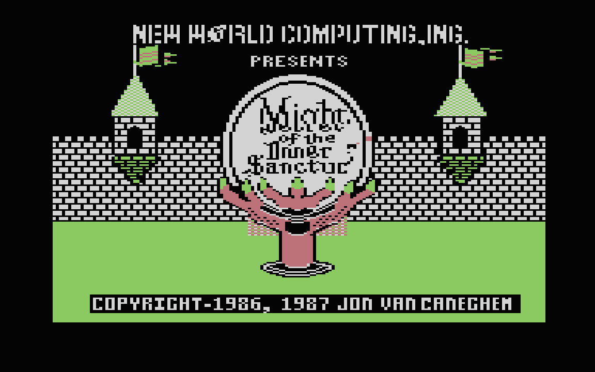
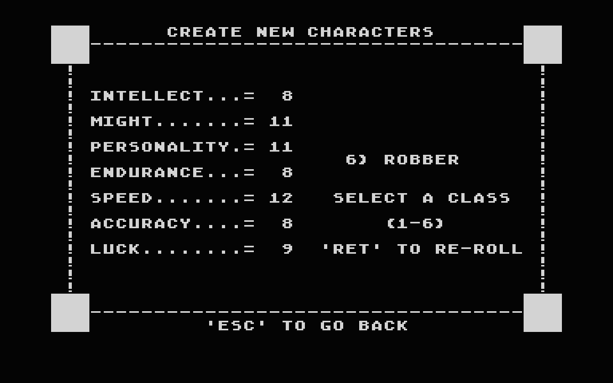
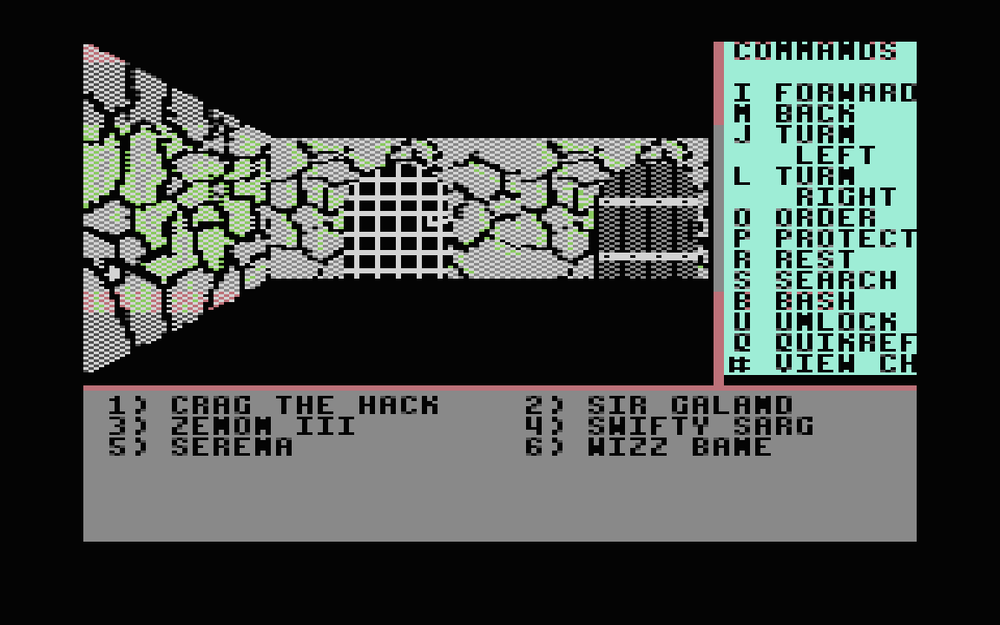
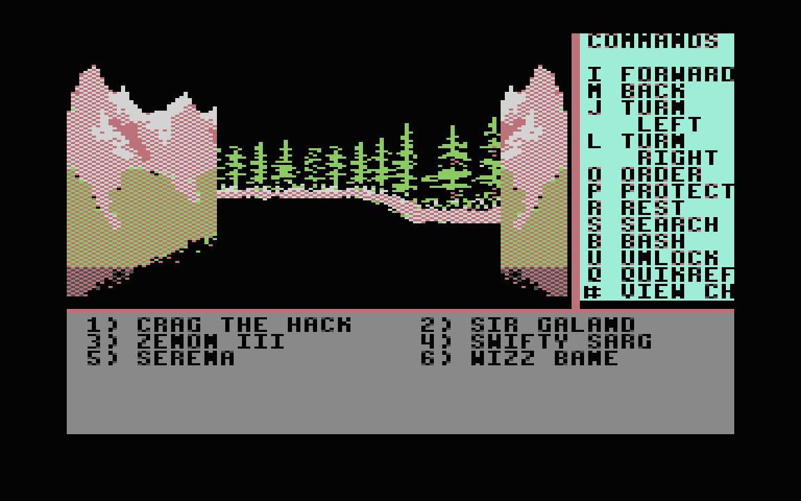
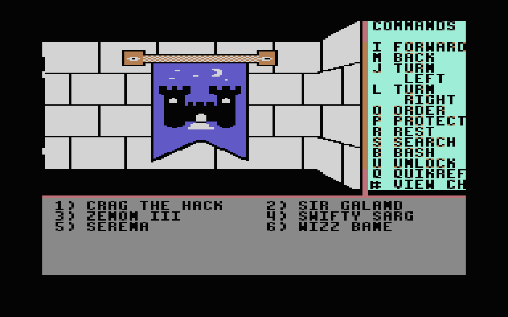

# Might and Magic: Book One for the Atari 130XE

*Might and Magic: Book One, Secret of the Inner Sanctum* (New World Computing, 1986/87), running on an **Atari 130XE** from four disks, with the colour screen, the keyboard, the sound, the disk swaps and the saved games of the original.

> **This is an unofficial fan port.** It is not made, endorsed or supported by New World Computing, 3DO, Ubisoft or any other owner of the game. *Might and Magic* and everything in the original game, its code, graphics, text, music, sound and data, are the copyright and trademark of **New World Computing, Inc.** and of the present owners of those rights. See "Rights and credits" below.

This is not a rewrite. The C64 game's own 6502 code runs on the Atari, unchanged apart from the few instructions that address the C64's video, sound and timer chips. A small Atari kernel stands in for the rest of the C64 (screen, keys, sound, disk). The game's rules, its random numbers, its disk traffic and its save files are the original's, checked against the C64 version key by key.



| | |
| --- | --- |
|  |  |
|  |  |

## What is here

Four disk images, one for each C64 disk side. Each is an **enhanced-density** Atari disk (1,040 sectors of 128 bytes, 130 KB), which is what a stock 1050 drive formats.

| File | Disk | Holds |
| --- | --- | --- |
| `mm1-disk1.atr` | 1 (the C64's side A) | Boot disk: the title, the game's resident code. Boots the machine. |
| `mm1-disk2.atr` | 2 (side B) | Sorpigal, the dungeon beneath it, the roster. **Saved games are written here.** |
| `mm1-disk3.atr` | 3 (side C) | The country outside the town |
| `mm1-disk4.atr` | 4 (side D) | The far country and its castles |

The game asks for each disk in its own words, `INSERT DISK B AND PRESS 'RETURN'`, as it did on the C64 (its disks are A to D, these are 1 to 4).

SHA-256:

```
c038316fcf83516e01aaf891062e919210a67f167b31428a5eb2acd200e2040f  mm1-disk1.atr
ae68b29be9312a3063f5a78cf1fe4f5dec99e15c7b63274d6e10cdff113002dd  mm1-disk2.atr
a78fac5aeaaaf677e30e6a7909bdb84ea0f702e8b1e8152d00bb70d70420e9e5  mm1-disk3.atr
4ebe7d765bb632e7759c8c817bd9b6f45488ae17dcda7b8454aaebc6827a36bd  mm1-disk4.atr
```

## What you need

- An **Atari 130XE** (128 KB), or an emulator set up as one: 130XE, BASIC off, NTSC. The picture the game shows is built in an extended memory bank that ANTIC reads, so a 64 KB machine (65XE, 800XL) will not run it, nor will most third-party memory upgrades, which lack that bank switching.
- For a real machine, a drive that can read an enhanced-density (130 KB) disk, such as a stock 1050, and a way to write the images to disks (see "Real hardware").

## Running it in an emulator

Work on **copies** of the images: the game writes your characters to disk 2.

**Atari800** (Linux, macOS, Windows):

```
atari800 -xe -nobasic -ntsc -no-kbdjoy0 -no-kbdjoy1 mm1-disk1.atr
```

`-xe` is the 130XE. The two `-no-kbdjoy` options stop Atari800 from taking W, A, S, D and the numeric keypad as joystick keys, which would never reach the game. On Windows run `atari800.exe` the same way.

**Altirra** (Windows, or AltirraSDL on Linux): choose the 130XE, 128 KB, BASIC off, NTSC; boot `mm1-disk1.atr` in D1. Mount disk 2 **read/write** (not "virtual"), or the saved games are not kept.

### Playing

1. The C64 title program runs first: the title picture, its tune and, if you press SPACE, a few scenes. Press **ESC** to start. The game loads (about 8 seconds in an emulator with its fast disk option, about 30 with the emulator doing the serial transfers like a real drive; a real drive may be slower).
2. The game asks for disk B. In Atari800 press **F1**, open *Disk management*, insert `mm1-disk2.atr` in D1, close the menu, and press **RETURN**. In Altirra use the Disk menu to change D1. Press RETURN in the game.
3. The options menu offers `C` (create characters), `V` (view all characters) and `#` (go to town); the supplied six characters are at the Inn of Sorpigal. There **CTRL-A to CTRL-F** add the characters to the party.
4. Play with the keys shown on the screen: `I` forward, `M` back, `J` turn left, `L` turn right, `#` a character's sheet, and so on. The manual that came with the game applies.
5. When the party leaves Sorpigal for the outdoors the game asks for **disk C** (`INSERT DISK C AND PRESS 'RETURN'`), and later for disk **D**. Swap the disk in D1 as before and press RETURN. If you leave the wrong disk in, or none, the game simply asks again.
6. **Save** by signing in at the Inn of Sorpigal. The roster is written to disk 2, so disk 2 must be the writable image, and in the drive, when you sign in (the game asks for it if it isn't).

To start again after a restart, boot disk 1 again, then swap to disk 2 when asked: the party you saved is on disk 2.

## Real hardware

**Not tried yet.** Everything above was checked in the Atari800 and AltirraSDL emulators, including with the emulators' fast disk shortcut switched off so that the Atari OS's own serial code does every transfer. What a real 1050 will do, and how long loads take there, is not known. In particular:

- The images are ordinary ATR files of 1,040 sectors of 128 bytes (133,120 bytes plus the 16-byte header). Write them to real disks with a tool that can write enhanced-density ATRs (SIO2PC and its relatives, an Atari-to-PC link, or a modern floppy emulator).
- Disk 2 must not be write-protected: that is where the game saves.
- The first read after a disk change may fail on a real drive. If the prompt comes back, press RETURN again.
- Loads are slower than on an emulator: the game reads and unpacks a few KB each time it enters a new area, from a drive with a 128-byte, one-sector-at-a-time protocol.

If you try it, please tell me what happened.

## How it fits on four small disks

The C64 game has four 170 KB disk sides, each larger than an enhanced-density Atari disk. Every file and picture on a disk here is **compressed on its own** (ZX02) and padded to whole sectors, and the end of each disk holds an index that tells the loader where each block starts. The loader unpacks a sector at a time as it reads, so it needs no big buffer. The fullest disk is about 77% full. The roster, the monster records and the file table are stored as they are, because the game writes or reads them in pieces. The game's own file-table check and its `INSERT DISK` prompt do the rest: the Atari never needs to know which disk is in the drive.

## Differences from the C64 you will notice

- **Colour.** The C64 chooses colours for every 8×8 cell. The Atari's graphics mode allows three colours and the background for a whole row, so each row's palette is chosen from what is on it, and rare colours turn into their nearest neighbour. Monsters and the 3-D views are recognisable; some are not the colours the C64 gave them.
- **Speed.** The game's own work takes about the time it did on a C64, but turning the C64's picture into the Atari's costs about 0.4 seconds a screen, so a step in the 3-D view takes about half a second against the C64's 0.14.
- **Sound.** The game's sound effects and the title tune are translated from the C64's sound chip to the Atari's POKEY. The pitches are right; the voices and envelopes are approximate.
- **Keyboard.** The Atari keyboard stands in for the C64's. The ESC key is the C64's left-arrow ("Escape").

## Status

**Tested:** a recorded set of 21 play sessions, covering the menu, making and saving characters, all five town services, fights (won and lost, and retreat, bribe and surrender attempts), spells, shooting, chests and their traps, death and the temple, the outdoors, save and reload after a power cycle, and the swaps to disks B, C and D. On every one the game's memory equals the memory of a reference model of the C64 game at every checkpoint, and so does what it writes to the disk.

**Not tested:** a real Atari and a real drive; playing the whole game through; PAL machines (the picture timing is NTSC); the 64 KB machines (not supported).

## Source

The source of the port (the kernel, the build tools, the test harness and the design notes and log) **will be uploaded soon**.

## Rights and credits

- ***Might and Magic: Book One, Secret of the Inner Sanctum*** was created by **Jon Van Caneghem** and published by **New World Computing, Inc.** (1986; the title screen reads "Copyright 1986, 1987 Jon Van Caneghem"). All rights in the game, including its program code, artwork, text, music and sound effects, its name and its trademarks, belong to New World Computing and to whoever now holds those rights. "Might and Magic" is a trademark of its owners.
- **This is a fan project.** It is not affiliated with or approved by the rights holders. It was made out of admiration for the game and to learn how its 6502 code could run on another machine, the Atari 130XE. It is non-commercial, there is no charge for it, and no one may sell it.
- **The disk images contain the original game**, converted to run on the Atari: its code and data are New World Computing's, not the author's. They are shared for preservation and interest only, with no claim of ownership over any part of the game. If you do not own the original game you should not rely on these, and you should use them only where the law allows.
- **Atari**, **130XE**, **1050** and related names are trademarks of their owners. The port does not use any Atari ROM or software: the Atari's own operating system in your machine or emulator does the disk transfers.
- The ZX02 compressor and decoder used to fit the game on the disks are by Daniel Serpell and Einar Saukas (MIT and BSD-style licences), and will be credited with the source.
- If you are a rights holder and would like this changed or removed, please say so and it will be.
